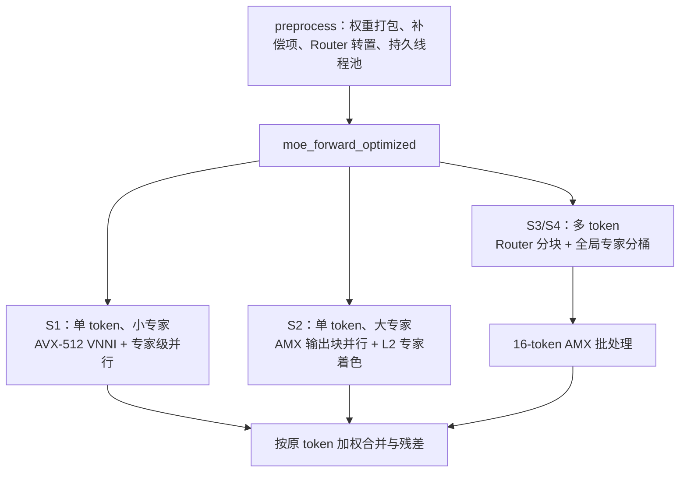

# MoE 优化总结与阶段性复盘

本文总结当前 [`student/moe_opt.cpp`](../student/moe_opt.cpp) 的优化架构、四个评测场景的针对性策略、已经验证的性能，以及优化过程中得到的经验。记录时间为 2026-07-29。

## 1. 优化目标与当前结果

四个评测场景为：

| 场景 | 参数 `(N, D, H, E, K)` | 目标 Speedup | 最近一次完整回归 | 阶段内最好结果 | 当前结论 |
|---|---:|---:|---:|---:|---|
| S1 | `(1, 256, 128, 16, 4)` | 20.0× | 15.0328× | 21.4232× | 单独测试曾达标，但尚不稳定 |
| S2 | `(1, 1024, 512, 16, 4)` | 15.0× | 19.4597× | 20.1263× | 已超过目标 |
| S3 | `(128, 256, 128, 16, 4)` | 100.0× | 117.431× | 117.431× | 已超过目标 |
| S4 | `(1024, 512, 128, 512, 2)` | 120.0× | 182.488× | 183.591× | 已超过目标 |

最近一次完整回归的正确性均通过。典型误差如下：

- S1、S2、S3 的相对 RMSE 约为 `1e-7`；
- S4 的全局相对 RMSE 为 `0.000246886`；
- S4 最差 token 的相对误差为 `0.00843211`；
- S4 对应容限分别为 `0.002` 和 `0.02`，仍有明显余量。

需要特别说明：S1 的 21.4232× 来自隔离单项测试，完整 1000 次回归仍会落到约 14–15×。因此当前不能把 S1 视为稳定完成。文档后文会说明已尝试但未奏效的 S1 调度方案。

## 2. 总体架构

当前实现不再用同一种循环覆盖所有形状，而是共享一套预处理结果，并根据 batch 和矩阵规模选择不同内核：



核心原则是：

1. 把不会随输入变化的工作全部移到 `preprocess`；
2. 单 token 优先降低启动、同步和访存延迟；
3. 多 token 优先把 GEMV 变成 AMX 擅长的 GEMM；
4. 调度不仅要均衡计算量，还要保持专家权重的私有 L2 复用；
5. 所有专家先写入独立输出区，最后统一合并，避免并行写 `y` 的数据竞争。

## 3. 预处理与权重布局

### 3.1 原生 VNNI/AMX Tile 打包

Gate、Up 和 Down 权重在计时前被转换为 1 KiB 的原生 B Tile。每个 Tile 对应：

```text
K block      = 64 个 INT8
output block = 16 个通道
Tile size    = 64 × 16 × 1 Byte = 1024 Bytes
```

Gate 和 Up 使用同一个输入，因此按消费顺序交错存储。微内核每次同时推进三个输出块，也就是六条独立的 Gate/Up 累加链。Down 每次推进六个输出块。最终布局近似为：

```text
Gate/Up: [3 个输出块][K block][Gate Tile, Up Tile]
Down:    [6 个输出块][K block][Down Tile]
```

这样做有三个收益：

- 前向阶段不再转置或 gather 权重；
- 同一激活块可以被多个累加器复用；
- 多条独立累加链可以隐藏 VNNI/AMX 点积延迟。

### 3.2 VNNI 的 signed INT8 精确补偿

Sapphire Rapids 上使用的 AVX-512 VNNI 指令是 `u8 × s8`，而模型语义要求 `s8 × s8`。当前实现将激活字节异或 `0x80`，等价于把 signed 激活变为：

$$
u_i=x_i+128.
$$

预处理阶段为权重的每个输出通道计算：

$$
c=-128\sum_i w_i.
$$

运行时以该补偿值初始化 INT32 累加器：

$$
c+\sum_i(x_i+128)w_i=\sum_i x_iw_i.
$$

因此可以使用高吞吐的 `VPDPBUSD`，同时保持与参考实现一致的 signed INT8 点积语义。

### 3.3 Router 转置

Router 权重从原始的 `[E][D]` 转换为：

```text
[expert block][D][16 experts]
```

一次 AVX-512 加载正好取得同一个输入维度对应的 16 个专家权重，避免为每个专家分别做水平归约。专家数不足 16 的尾部在预处理时补零。

### 3.4 工作区复用

量化输入、路由结果、专家分桶、专家临时输出和单 token 流水线工作区均在 `preprocess` 中一次性分配并按 64 Bytes 对齐。计时区内不执行大块动态内存分配。

## 4. Router、Top-K 与量化

### 4.1 Router 寄存器分块

Router 根据 batch 大小选择不同路径：

- 单 token 使用专用的一行 AVX-512 点积；
- 16 token 使用 `16 × 16` 寄存器分块，在推进输入维时复用 Router 权重；
- 非完整尾块使用小 batch 路径。

Router sigmoid 使用 AVX-512 的范围约简和多项式近似，避免逐元素调用标量 `exp`。Top-K 因为 `K <= 4`，采用一次扫描的插入式选择，并保持较小专家编号优先的平局规则。

### 4.2 激活量化

输入和 SwiGLU 隐藏量都使用 per-token scale：

$$
s=\frac{\max_i|x_i|}{127},\qquad q_i=\operatorname{round}(x_i/s).
$$

最大值归约、缩放和 FP32 到 INT8 转换全部使用 AVX-512。隐藏层的量化仍保持逐 token scale，没有用整个 batch 的统一 scale 改变数值语义。

## 5. 专家计算微内核

### 5.1 单 token 的 AVX-512 VNNI 路径

单 token 使用 GEMV 型 VNNI 内核：

1. Gate/Up 同时计算；
2. INT32 结果反量化；
3. 计算 `SiLU(Gate) * Up`；
4. 对隐藏量重新量化；
5. 执行 Down 投影；
6. 转为 FP32 专家输出。

S1 的固定形状 `D=256, H=128` 还有完全展开的专用版本：

```text
Gate/Up 输出块：3 + 3 + 2
Down 输出块：   6 + 6 + 4
```

固定循环边界减少了通用内核中的分支、动态索引和尾块判断。

### 5.2 多 token 的 AMX 路径

AMX 以最多 16 个 token 为一批：

```text
A Tile: M × 64 INT8，1 <= M <= 16
B Tile: 64 × 16 INT8，已在 preprocess 中打包
C Tile: M × 16 INT32
```

Gate/Up 同时维护六个 Tile 累加器，Down 同时维护六个输出 Tile。Tile 配置由持久线程预先加载，避免每个小任务重复申请 AMX 权限或重复创建线程。

## 6. 持久线程池与 CPU 资源

重复进入 OpenMP 并行区对 S1、S2 的单次延迟影响很大。当前在 `preprocess` 中创建持久工作线程，并将线程固定到允许的 CPU 集合。

线程池当前包含以下优化：

- 主线程也参与任务，减少一个纯调度线程；
- 用 generation 发布一次前向任务；
- 每个工作线程有独立的完成标志，避免所有线程在同一计数器缓存线上执行原子加；
- 小任务不需要的线程可通过 futex 休眠，降低无效自旋造成的封装功耗；
- AMX 权限和 Tile 配置按线程保存。

[`1.sh`](../1.sh) 请求 `16` 个逻辑 CPU。该分区开启 SMT，16 个逻辑 CPU 实际对应 8 个物理核；原先请求 8 个逻辑 CPU 时只能获得 4 个物理核，无法支持当前的八核专家调度。线程池选取 CPU 集合中的前 8 个不同物理核，SMT sibling 不参与主要计算。

## 7. 各场景的针对性策略

### 7.1 S1：小专家、极低延迟

S1 每个 token 需要一个共享专家和四个路由专家。已经验证过的较优方案是：

- Router、Top-K 和输入量化由主线程完成；
- 五个完整专家分别交给五个执行者；
- 每个专家内部使用 S1 专用 VNNI 内核；
- 每个专家写独立的 256 维输出；
- 主线程最后执行残差和 gate 加权合并。

这种方案只有一次线程池发布和一次完成等待，没有专家内部的跨核中间数据交换。隔离测试最好达到 21.4232×，但长测和完整回归对频率及系统扰动较敏感。

当前代码中还保留了一版实验性的 Router/专家融合调度：主核计算 Router，一个工作核立即计算共享专家，其余工作核等待路由结果后计算四个路由专家。理论上它可以把 Router 与共享专家重叠，但正式测试首轮只有 14.202×，连续运行还会下降到约 11×。原因是多启用一个 AVX-512 物理核带来的频率下降和同步成本大于被隐藏的 Router 时间。这一实验不应作为最终 S1 方案。

### 7.2 S2：大专家与 L2 专家着色

S2 的单个专家权重较大，完整专家交给单核会受单核 L2/L3 带宽限制。当前把 Gate/Up 和 Down 的输出块分散到 8 个核，并在两个数据依赖边界同步：

```text
并行 Gate/Up -> 隐藏量量化 -> 并行 Down
```

单纯动态抢任务虽然表面负载更均衡，却会让同一个专家的权重在不同调用中迁移到不同核心，破坏私有 L2 复用。当前使用根据专家编号确定的固定旋转着色表，让同一个专家的 Tile 尽量由固定核心消费。

该策略连续得到约 20×；动态均衡方案曾因 L3 带宽波动下降到 8.60×，说明在这一形状下缓存归属比细粒度的瞬时均衡更重要。

### 7.3 S3：中等 batch、少量专家

S3 先以 16 token 为块完成 Router 和输入量化，再建立整个 batch 的专家桶。每条路由记录保存 token 编号和 gate：

```text
token -> Top-K -> count per expert -> prefix sum -> bucket entries
```

共享专家直接处理全部 128 个 token；路由专家一次处理桶内属于自己的 token。每个专家内部按 16 行组成 AMX batch，把大量小 GEMV 转换为 Tile GEMM。最后根据分桶记录 scatter 并合并输出。

### 7.4 S4：大 batch、大专家数、稀疏激活

S4 有 512 个专家，但每个 token 只选择 2 个，因此实际路由专家任务总数只有：

$$
N K=1024\times2=2048.
$$

优化重点不是遍历并计算全部 512 个专家，而是：

- Router 按 16 token、16 expert 做寄存器分块；
- 用全局计数和前缀和构造 2048 条有效分桶记录；
- 跳过空专家；
- 对非空专家按最多 16 token 使用 AMX；
- 共享专家对完整 batch 批量执行；
- 最后按 token 合并两个路由结果。

该路径同时获得了最高的绝对加速和足够的正确性余量。

## 8. 已尝试但未保留的方案

### 8.1 S1 使用单行 AMX

AMX 的理想 Tile 有 16 行，S1 只有一行，计算单元利用率很低。完整专家单行 AMX 实测约为 5.8 μs/次，明显慢于 VNNI，因此 S1 继续使用 VNNI。

### 8.2 S1 把专家拆成大量输出块

曾尝试把五个专家拆成 15 个 Gate/Up 块，再经过全局屏障、量化和 15 个 Down 块分配到 8 核。实测约 9.8 μs/次。另一个仅使用一次屏障、Down 保持整专家的版本也约为 4.16 μs/次。

主要问题是：

- 微任务太短，屏障和任务发布占比过高；
- Gate/Up 中间结果跨核迁移；
- 权重的私有 L2 归属被打乱；
- 更多 AVX-512 活跃核心会降低运行频率。

### 8.3 S2 动态任务均衡

动态领取任务在部分输入上很快，但专家权重会不断换核，性能波动很大。固定专家着色虽然理论负载未必最优，却能提供更可重复的 L2 命中和端到端性能。

## 9. 目前最重要的经验

1. **预处理布局必须服务于具体微内核。** 只做转置而不按内核消费顺序组织 Tile，仍会在热循环中产生地址计算和不连续读取。
2. **小 batch 看延迟，大 batch 看吞吐。** S1 适合 VNNI 和粗粒度任务；S3/S4 适合分桶和 AMX。
3. **任务越细不代表越快。** 数微秒级前向中，一次额外屏障就可能抵消多个核心带来的计算收益。
4. **负载均衡必须同时考虑缓存归属。** S2 的固定专家着色比动态调度稳定得多。
5. **尽量让同步缓存线单写。** 每线程独立完成标志比所有线程原子递增一个计数器更适合高频短任务。
6. **性能结论必须来自完整回归。** S1 单测达到 20×并不等价于在四场景连续运行时稳定达到 20×。

## 10. 后续工作

当前下一步应集中在 S1，而不应改动已达标的 S2–S4：

1. 回退未带来收益的 Router/专家融合实验，恢复五个完整 VNNI 专家并行；
2. 对 S1 分段测量 Router、量化、线程池发布/等待、专家内核和最终合并的周期数；
3. 优先减少线程池固定成本和 S1 专用 VNNI 内核的指令数，同时保持专家与核心的稳定映射；
4. 用多个独立的 1000 次正式任务验证尾部表现，而不是只采纳单次最好值；
5. 最后重新执行四形状正确性、完整性能回归和 `git diff --check`。

