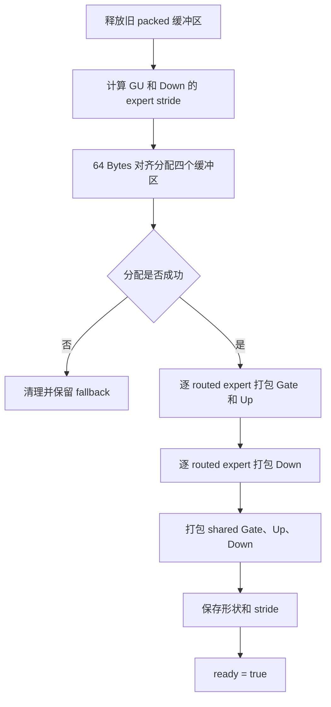
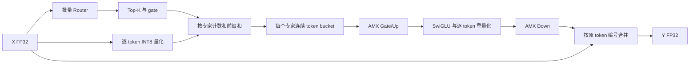

# MoE 权重预处理与 AMX/VNNI 优化设计

本文记录 `student/moe_opt.cpp` 中权重预处理的优化思路，并说明后续如何让
AVX-512 VNNI 和 Intel AMX 内核直接使用预打包后的权重。目标平台是实验所用的
Intel Sapphire Rapids，优化目标是四个评测场景的端到端运行时间，而不是单独追求
`preprocess` 本身的速度。

相关实现位于 [`student/moe_opt.cpp`](../student/moe_opt.cpp)。

## 1. 当前状态

当前已经完成：

- 为 routed expert 和 shared expert 分配独立的 packed 权重缓冲区；
- 缓冲区按 64 Bytes 对齐；
- 将 Gate 和 Up 权重组织到同一片连续存储空间；
- 将 Gate、Up 和 Down 权重转换为 AMX `TDPBSSD` 所需的 B Tile 布局；
- packed 布局同时适合 AVX-512 VNNI 的 16 输出通道并行点积；
- 保留原始权重，保证计时结束后的 reference 实现仍能正确读取它们；
- 内存分配失败时保留回退到原始布局的能力；
- 去掉 token 内部的细粒度 OpenMP 并行，避免频繁进入并行区。

当前尚未完成：

- 标量 `expert_ffn` 尚未改为读取 packed 权重；
- 尚未实现 AVX-512 VNNI GEMV 内核；
- 尚未实现 AMX INT8 GEMM 内核；
- 大 batch 尚未完成按专家分桶，因此 routed expert 仍是逐 token 计算。

因此，当前预打包属于后续高性能内核的基础设施。只有 forward 真正消费 packed
权重后，预处理才会转化为计时区内的性能收益。

## 2. 为什么需要权重预处理

原始专家权重按普通行优先形式保存：

```text
W_gate[e][H][D]
W_up[e][H][D]
W_down[e][D][H]
```

这种布局适合参考实现逐行计算矩阵向量乘：

```cpp
for (int row = 0; row < output_dim; ++row) {
    for (int k = 0; k < reduction_dim; ++k) {
        output[row] += weight[row][k] * input[k];
    }
}
```

但是 AMX 并不是逐行读取一个普通矩阵。`TDPBSSD` 每次从 K 维取四个连续 INT8，
并把它们与多个输出列对应的四个权重相乘。若 forward 中临时转置或 gather 权重，会产生：

- 大量不连续访存；
- 每次 forward 都重复支付布局转换开销；
- Tile 加载前需要额外的临时缓冲区；
- 相同权重在多个 token 之间无法稳定复用；
- AMX/VNNI 的计算吞吐被数据准备速度限制。

专家权重在多次 forward 之间保持不变，而 `preprocess` 在计时之前只调用一次。因此，
可以把所有重排成本移出计时区：

```text
原始权重
   │
   │ preprocess，仅执行一次
   ▼
AMX/VNNI packed 权重
   │
   ├── 单 token：VNNI GEMV
   └── 多 token：AMX GEMM
```

这是一种典型的“以额外内存换取运行时连续访存和更高计算吞吐”的优化。

## 3. AMX INT8 点积的计算原理

对逻辑矩阵乘法

$$
C_{M\times N}=A_{M\times K}B_{K\times N},
$$

本实验中 $A$ 和 $B$ 都是 signed INT8，结果累加到 INT32。Sapphire Rapids 上使用
`_tile_dpbssd`，其核心计算为：

$$
C_{m,n}\mathrel{+}=
\sum_{r=0}^{3}A_{m,4k+r}B_{4k+r,n}.
$$

一个满尺寸计算块可以选择：

```text
A: 16 × 64 INT8   = 1024 Bytes
B: 64 × 16 INT8   = 1024 Bytes（逻辑形状）
C: 16 × 16 INT32  = 1024 Bytes
```

Tile 最多只有 16 行，因此逻辑上具有 64 行的 B 不能直接按普通行优先布局加载。
AMX 要求将 B 的每四行打包为一个物理行：

$$
B_{pack}[k][4n+r]=B[4k+r][n],\qquad r=0,1,2,3.
$$

于是 B 的 packed 物理形状为：

```text
16 行 × 64 Bytes = 1024 Bytes
```

其中一行的内容为：

```text
B[k+0][n+0], B[k+1][n+0], B[k+2][n+0], B[k+3][n+0],
B[k+0][n+1], B[k+1][n+1], B[k+2][n+1], B[k+3][n+1],
...
B[k+0][n+15], B[k+1][n+15], B[k+2][n+15], B[k+3][n+15]
```

这正是当前 `pack_matrix` 生成的布局。

## 4. 从原始专家权重推导 packed 布局

专家权重在 C++ 中保存为：

$$
W[output][K].
$$

执行 token batch 与权重的乘法时，数学形式为：

$$
X_{M\times K}W^T_{K\times output}.
$$

因此 AMX 的 B 操作数实际来自 $W^T$。不必真的先生成一个完整转置矩阵，可以直接从
原始 `W[output][K]` 写入最终 packed 位置。

定义：

```text
ob = output / 16             // 输出通道块
kb = K / 64                  // K 维块
kg = 块内四元素组，范围 0..15
n  = 块内输出通道，范围 0..15
r  = 四元素组内位置，范围 0..3
```

则转换关系为：

```cpp
packed[ob][kb][kg][n * 4 + r]
    = W[ob * 16 + n][kb * 64 + kg * 4 + r];
```

展平成一维地址后：

```cpp
packed_offset =
    (((ob * k_blocks + kb) * 16 + kg) * 64)
    + n * 4 + r;
```

每个 `(ob, kb)` 对应一个完整的 1024 Bytes B Tile，因此 forward 中可以直接计算：

```cpp
const int8_t* b_tile = packed
    + (ob * k_blocks + kb) * 1024;
```

无需再次转置或复制。

实验保证 $D$ 和 $H$ 都是 64 的倍数，所以：

- K 维一定可以完整切分为 64 元素块；
- 输出维一定可以完整切分为 16 通道块；
- 当前四个评测场景不需要权重尾块处理；
- 每个 packed 矩阵大小与原始矩阵相同，只改变排列顺序。

## 5. Gate 和 Up 为什么放在一起

SwiGLU 的前两个投影为：

$$
V_g=W_gX_q,
\qquad
V_u=W_uX_q.
$$

它们具有以下共同点：

- 输入都是同一个 $X_q$；
- 输入维度都是 $D$；
- 输出维度都是 $H$；
- 两个结果必须同时准备好，才能计算
  $\operatorname{SiLU}(V_g)\odot V_u$。

因此可以把逻辑输出维拼接为：

$$
W_{gu}=
\begin{bmatrix}
W_g\\
W_u
\end{bmatrix}
\in\mathbb Z_8^{2H\times D}.
$$

当前实现的物理存储为：

```text
packed Gate: H × D Bytes
packed Up:   H × D Bytes
```

二者位于同一片连续缓冲区中。因为 $H$ 是 64 的倍数，Gate 与 Up 的边界也一定是
完整 Tile 边界，不会出现一个 16 输出通道 Tile 同时包含 Gate 和 Up 的情况。

后续内核可以复用同一个激活 Tile：

```text
             ┌── packed Gate Tile ──> Gate INT32 accumulator
Xq Tile ─────┤
             └── packed Up Tile   ──> Up INT32 accumulator
```

这不会减少 INT8 乘加总数，但可以减少激活数据的重复加载，并提高寄存器或 Tile 中的数据
复用率。

## 6. PackedWeights 的内存组织

当前维护四个 64 Bytes 对齐的缓冲区：

```text
routed_gu    [E][2H][D]
routed_down  [E][D][H]
shared_gu        [2H][D]
shared_down      [D][H]
```

这里展示的是逻辑容量，内部均使用前述 Tile-packed 排列。

每个 routed expert 的跨度为：

$$
stride_{gu}=2HD,
\qquad
stride_{down}=DH.
$$

第 $e$ 个专家的起始地址为：

```cpp
gu_e   = routed_gu   + e * gu_expert_stride;
down_e = routed_down + e * down_expert_stride;
```

64 Bytes 对齐具有三个作用：

- AVX-512 可使用对齐的 512-bit 加载；
- 每个 packed Tile 的起始地址自然保持 64 Bytes 对齐；
- 连续扫描时减少跨 cache line 的非必要加载。

### 6.1 内存开销

预打包不会扩大单个矩阵本身，但因为 reference 校验仍需要原始权重，所以需要同时保留
原始副本和 packed 副本。额外空间约为：

$$
(E+1)\times3HD\ \text{Bytes}.
$$

例如 S4：

```text
E=512, D=512, H=128
```

routed expert 的额外 packed 空间约为：

$$
512\times3\times512\times128
=100,663,296\ \text{Bytes}
\approx96\ \text{MiB}.
$$

这是可观但可控的空间成本。若部署环境不再需要 reference，实际推理系统可以释放原始布局，
只保留 packed 权重。

## 7. preprocess 的执行流程

`preprocess` 的总体流程如下：



若 `preprocess` 可能被重复调用，首先释放旧缓冲区，避免泄漏和误用旧形状的数据。

内存分配失败时将 `ready` 保持为 `false`。后续高性能内核应检查：

```cpp
if (!packed_w.ready ||
    packed_w.d_model != w.d_model ||
    packed_w.d_ff != w.d_ff ||
    packed_w.num_experts != w.num_experts) {
    // 使用原始布局的正确性 fallback
}
```

### 7.1 是否需要并行执行 preprocess

从数据依赖看，不同专家的预打包完全独立，可以安全地写成：

```cpp
#pragma omp parallel for schedule(static)
for (int e = 0; e < num_experts; ++e) {
    pack_expert(e);
}
```

每个线程写入完整、互不重叠的 expert range，不需要锁，也不会发生输出数据竞争。

但实验只计时 `moe_forward_optimized`，不计时 `preprocess`。因此并行预处理只能缩短程序启动
时间，不能提高评分中的 Speedup。当前实现有意保持串行，优先保证本地 AVX2 环境和实验平台
构建参数下都能稳定运行。若后续需要优化模型加载时间，再开启专家级静态并行即可。

这里需要区分两个概念：

- **并行执行预处理**：让权重转换本身更快，主要优化启动时间；
- **为并行计算预处理权重**：生成 AMX/VNNI 友好的布局，优化每一次 forward。

本实验高分主要依赖第二项。

## 8. 如何用 AVX-512 VNNI 消费该布局

对于 `N=1` 的 S1、S2，分桶和 AMX GEMM 的准备成本可能大于收益，因此应使用低开销
VNNI GEMV。

一个 packed Tile 包含 16 个输出通道、每个通道 64 个权重。VNNI 可以每次广播四个
signed INT8 激活，并同时更新 16 个 INT32 输出：

```cpp
__m512i acc = _mm512_setzero_si512();

for (int kg = 0; kg < 16; ++kg) {
    // xq 中连续四个 signed INT8，按 32-bit 模式广播到所有 lane。
    int32_t x4;
    memcpy(&x4, xq + k_base + kg * 4, sizeof(x4));
    __m512i vx = _mm512_set1_epi32(x4);

    // 16 个输出通道，每个通道四个 signed INT8 权重。
    __m512i vw = _mm512_load_si512(
        packed_tile + kg * 64);

    acc = _mm512_dpbssd_epi32(acc, vw, vx);
}
```

这里 `acc` 的 16 个 INT32 lane 分别对应 16 个输出通道。

与“每个输出通道独立扫描一次输入”的普通 GEMV 相比，这种循环顺序具有以下优势：

- 一个四字节激活组被 16 个输出通道复用；
- packed 权重始终以 64 Bytes 连续加载；
- 不需要从 INT8 逐元素扩展为 INT32 再乘法；
- `_mm512_dpbssd_epi32` 保持本实验所需的 signed × signed 语义；
- 可以同时维护 Gate 和 Up 两组 accumulator，进一步复用激活广播。

不能简单使用 AVX2 的 `vpmaddubs` 替代 signed × signed VNNI。该指令的一侧输入是 unsigned，
而且具有中间饱和语义；如果没有符号修正和补偿项，结果可能错误。

## 9. 如何用 AMX 消费该布局

AMX 更适合一个专家同时处理多个 token。假设专家 $e$ 收到 $M_e$ 个 token，先把量化输入
连续组织为：

$$
X_q^{(e)}\in\mathbb Z_8^{M_e\times D}.
$$

### 9.1 Gate 和 Up

计算：

$$
A_{gu}^{(e)}=X_q^{(e)}(W_{gu}^{(e)})^T
\in\mathbb Z_{32}^{M_e\times2H}.
$$

以一个 `16×64×16` 块为例：

```cpp
_tile_zero(C_tile);

for (int kb = 0; kb < D / 64; ++kb) {
    _tile_loadd(A_tile, xq_block + kb * 64, xq_stride);
    _tile_loadd(B_tile, packed_weight_tile(kb), 64);
    _tile_dpbssd(C_tile, A_tile, B_tile);
}

_tile_stored(C_tile, int32_output, output_stride);
```

其中 B Tile 就是 `preprocess` 已经生成的 1 KiB 连续块。

Gate 和 Up 可以采用两种方式：

1. 依次计算 Gate 和 Up，共用已位于 cache 中的输入；
2. 同时维护 Gate、Up 两组 C Tile，在一次 A Tile 加载后分别执行两次 `_tile_dpbssd`。

第二种方式减少 A Tile 加载次数，但占用更多 Tile 寄存器，需要结合 Tile 数量和 TMUL 延迟
进行实测。

### 9.2 SwiGLU 与重量化

AMX 得到的是 INT32 accumulator。对桶中第 $t$ 个 token：

$$
V_{g,t,f}=A_{g,t,f}s_{x,t}s_g^{(e)},
$$

$$
V_{u,t,f}=A_{u,t,f}s_{x,t}s_u^{(e)},
$$

$$
H_{t,f}=\operatorname{SiLU}(V_{g,t,f})V_{u,t,f}.
$$

随后仍必须逐 token 计算 hidden scale：

$$
s_{h,t}=\frac{\max_f|H_{t,f}|}{127},
\qquad
H_{q,t,f}=\operatorname{round}(H_{t,f}/s_{h,t}).
$$

这里不能让一个 Tile 内所有 token 共用同一个 scale，否则会改变参考实现的 per-token 量化语义。
最大值归约、反量化、SiLU 和重量化适合用 AVX-512 FP32/INT32 指令完成。

### 9.3 Down 投影

Down 投影为：

$$
A_d^{(e)}=H_q^{(e)}(W_d^{(e)})^T
\in\mathbb Z_{32}^{M_e\times D}.
$$

它与 Gate/Up 使用相同的 AMX B Tile 格式，只是 K 维从 $D$ 变为 $H$，输出维从 $H$
变为 $D$。因此同一个 AMX 核心循环可以复用，只需要传入不同的：

- packed 权重地址；
- K block 数量；
- 输出 block 数量；
- 输入和输出 stride。

## 10. 为什么大 batch 需要按专家分桶

参考实现以 token 为中心：

```text
token 0 -> expert 3, 7, 10, 12
token 1 -> expert 3, 5, 10, 15
token 2 -> expert 3, 7, 11, 12
```

这种执行顺序会不断在多个专家的大块权重之间切换。即使权重已经预打包，也无法充分利用
AMX，因为每次仍只有一个 token，相当于 GEMV。

应改为专家视角：

```text
expert 3  -> token 0, 1, 2
expert 5  -> token 1
expert 7  -> token 0, 2
expert 10 -> token 0, 1
...
```

完整流水线为：



分桶后同一个专家的 packed 权重可以服务多个 token：

- 权重在 cache 和 Tile 中得到复用；
- GEMV 转换为 GEMM，提高算术强度；
- 每个专家成为独立的大任务，便于线程级并行；
- forward 不再需要任何权重重排。

## 11. 四个评测场景的内核分派

不能用同一种内核处理所有形状。推荐根据 `N` 和每个专家的 token 数 $M_e$ 分派：

| 场景 | 特征 | 推荐路径 |
| --- | --- | --- |
| S1 | `N=1,D=256,H=128` | packed VNNI GEMV，避免分桶与 AMX 配置开销 |
| S2 | `N=1,D=1024,H=512` | packed VNNI GEMV；可尝试单 token AMX，但必须实测 |
| S3 | `N=128,E=16,K=4`，平均 `M_e≈32` | 按专家分桶，shared 和 routed 均使用 AMX GEMM |
| S4 | `N=1024,E=512,K=2`，平均 `M_e≈4` | Router 批量化；shared 用 AMX；routed 使用小 AMX/VNNI 混合内核 |

可使用经验阈值：

```cpp
if (M_e >= amx_threshold) {
    expert_amx(...);
} else {
    expert_vnni(...);
}
```

阈值不能只看理论算力。AMX 还包含 Tile 配置、输入分桶、尾块补零以及中间矩阵写回成本，
应在 Sapphire Rapids 实机上分别测试 `M_e=1,2,4,8,16,32` 后确定。

## 12. 线程级并行策略

### 12.1 当前 token 并行

不同 token 完全独立，因此当前大 batch 使用最外层 token 并行：

```cpp
#pragma omp parallel for schedule(static)
for (int t = 0; t < num_tokens; ++t) {
    forward_one_token(t);
}
```

这种方式简单，并且 S3/S4 已有明显收益。token 内部不应再为 Router、量化或输出合并分别创建
短 OpenMP 并行区，否则会产生嵌套并行和频繁同步。

### 12.2 分桶后的专家并行

完成专家分桶后，可以改为：

```cpp
#pragma omp parallel for schedule(dynamic, 1)
for (int e = 0; e < num_experts; ++e) {
    if (expert_count[e] != 0) {
        process_expert_bucket(e);
    }
}
```

专家收到的 token 数可能不均匀，因此：

- S3 中专家较少且每个桶较大，可以比较 `static`、`dynamic` 和按工作量排序；
- S4 中专家多但桶很小，逐专家动态调度可能过细，应把多个小桶组合为一个任务；
- shared expert 是一个规则的大 GEMM，可以单独处理或与 routed 阶段流水化；
- 不要让外层 OpenMP 和内层多线程矩阵库同时创建线程。

### 12.3 输出合并

若多个专家线程直接执行：

```cpp
y[token][d] += gate * expert_output[d];
```

同一 token 的多个专家会并发写入同一输出行，产生数据竞争。更安全的方式是专家输出先写入
独立缓冲区，全部完成后按 token 并行：

```cpp
#pragma omp parallel for schedule(static)
for (int t = 0; t < num_tokens; ++t) {
    y[t] = x[t] + shared_output[t];
    for (int k = 0; k < top_k; ++k) {
        y[t] += gate[t][k] * routed_output[t][k];
    }
}
```

这样每个输出行始终只有一个线程写入。

## 13. ISA 分派与本地调试

实验平台支持 Sapphire Rapids 指令，但当前 WSL 开发环境只暴露 AVX2/AVX-VNNI，直接让整个
文件按 `-march=sapphirerapids` 运行会触发 `Illegal instruction`。

因此应保留一个可移植 fallback，并给高性能内核单独添加 target 属性：

```cpp
__attribute__((target("avx512f,avx512bw,avx512vl,avx512vnni")))
static void expert_vnni(...);

__attribute__((target("amx-tile,amx-int8,avx512f,avx512bw")))
static void expert_amx(...);
```

运行时分派示意：

```cpp
if (cpu_and_os_support_amx()) {
    expert_amx(...);
} else if (__builtin_cpu_supports("avx512vnni")) {
    expert_vnni(...);
} else {
    expert_fallback(...);
}
```

AMX 除了 CPU 指令支持，还要求操作系统允许当前线程使用 Tile state。在 Linux 上可能需要通过
`arch_prctl` 请求 `XTILEDATA` 权限；并且每个进入 AMX 内核的 OpenMP 工作线程都必须具备相应
权限。不能仅根据 CPUID 判断后立即执行 Tile 指令。

## 14. 正确性约束

布局重排只能改变权重的物理顺序，不能改变数学语义。后续接入 VNNI/AMX 时必须保持：

- INT8 输入和权重都是 signed；
- 乘积使用 INT32 累加；
- Gate、Up、Down 分别使用自己的权重 scale；
- 输入量化 scale 是 per-token；
- hidden 重量化 scale 也是 per-token；
- Top-K 使用 `sigmoid(logit) + bias`；
- gate 归一化只使用未加 bias 的原始 sigmoid；
- shared expert 不乘 routed gate；
- 相同选择分数仍优先较小专家编号；
- routed 输出合并不能发生并发写冲突；
- AMX 尾行使用 padding 时，不能把补零行回写为真实 token；
- 原始权重在 reference 校验完成前不能被覆盖或释放。

AMX/VNNI 的整数点积本身应与标量实现精确一致。可能产生容差内差异的部分主要是：

- Router FP32 求和顺序；
- SiLU 的实现；
- FP32 最大值归约；
- routed expert 输出的加权合并顺序。

每完成一个内核阶段，都应分别运行四个官方形状，而不是只测试性能最好的大 batch。

## 15. 性能收益来自哪里

权重预打包本身不减少 MAC 数。其收益来自降低每次 forward 的数据准备成本，以及让更高吞吐
的硬件单元能够连续工作。

### 15.1 连续访存

每个 B Tile 是连续 1024 Bytes，AMX 可以直接加载，不再逐列 gather。VNNI 每次也正好连续
加载一个 64 Bytes cache line。

### 15.2 激活复用

同一个四字节激活组可以同时参与 16 个输出通道的 VNNI 点积；同一个 AMX A Tile 可以服务
Gate 和 Up 的多个 B Tile。

### 15.3 权重复用

按专家分桶后，一个权重 Tile 可以连续处理最多 16 个 token，而不是每个 token 重新从更低层
cache 读取完整专家权重。

### 15.4 提高算术强度

逐 token GEMV 通常受内存带宽限制；分桶后的 GEMM 在加载一次权重后完成更多 INT8 MAC，
提高了每个权重字节对应的计算量，更接近 AMX 的吞吐能力。

### 15.5 减少调度与同步

把工作组织为 token block 或 expert bucket 后，每个 OpenMP 任务包含足够多的计算，避免在
长度只有 128、256 或 512 的循环上反复创建并行区。

## 16. 推荐实现顺序

建议按照以下顺序继续，便于逐步验证和定位问题：

1. 实现读取 packed 权重的 AVX-512 VNNI 点积内核；
2. 用 VNNI 替换单 token Gate、Up、Down，重点优化 S1/S2；
3. SIMD 化输入量化、hidden 重量化和输出合并；
4. 批量计算 Router，特别优化 S4 的 `N×E` 路由矩阵；
5. 先为 shared expert 实现 AMX GEMM，因为它处理所有 token 且无需分桶；
6. 实现 routed token 的计数、前缀和与连续分桶；
7. 为 routed expert 实现 AMX GEMM；
8. 对小桶增加 VNNI fallback，并在实验平台标定 AMX 阈值；
9. 调整 OpenMP 的专家任务粒度、线程绑定和调度策略；
10. 使用 profiler 检查热点、cache miss、AMX 利用率和线程负载均衡。

整个优化过程应始终保留标量 fallback。这样既可以在没有 AVX-512/AMX 的机器上调试，也可以
在每次引入新内核后逐阶段比较 packed 内核和参考路径的结果。
