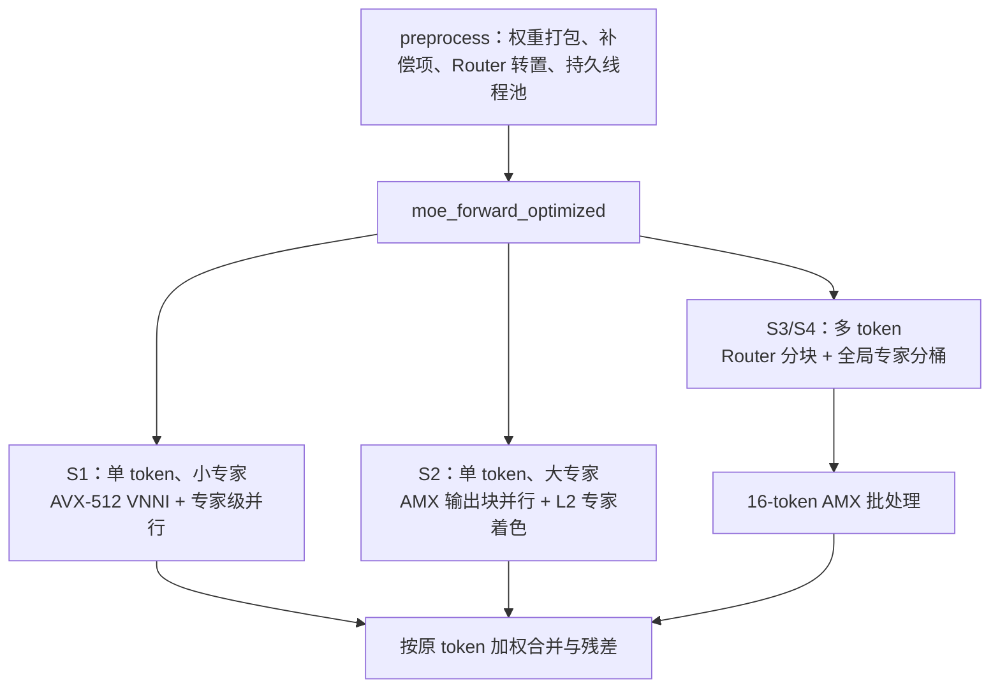
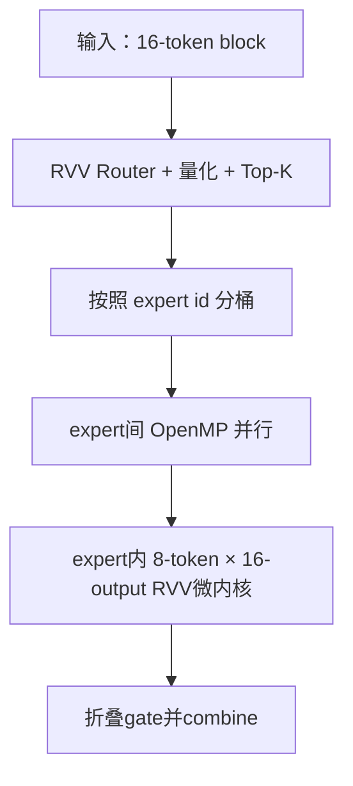

# Lab2: MoE 的向量化计算

<center>Grapesea</center>

[TOC]

> 本次实验将实现并优化一个 DeepSeek-V3 风格的量化 MoE 层前向计算：
>
> - 理解 MoE 的计算模式：路由、专家分发、加权合并
> - 理解量化推理（W8A8）中整数与浮点混合的计算流水线
> - 掌握向量化优化的通用方法：识别热点、数据重排、提高算术强度
> - Bonus：在 RISC-V 平台上实现 MoE 算子
>
> Bonus 实验：以 RISC-V 的 V (Vector) 和进迭时空的 IME 矩阵扩展为例，向同学们介绍与 AVX, AMX 不同的向量 / 矩阵扩展设计思路。旨在让感兴趣的同学了解开放指令集架构 RISC-V 的生态，学习能够适配不同向量单元长度的向量扩展的设计，进而对向量化加速有更深入的理解. 
>
> 参考文档：
>
> [Intrinsics-viewer](https://dzaima.github.io/intrinsics-viewer/)
>
> 

## 环境配置

用`degit`拉取部分资源：

```bash
npx degit ZJUSCT/HPC101/src/lab2 lab2
```

连接集群：

```bash
ssh -p 443 h3240104505+test+hpc101@clusters.zju.edu.cn
```

运行方法：

```bash
cd src/lab2
cmake -B build
cmake --build build
./build/lab2 128 256 128 16 4      # N D H E K
./build/lab2 1 1024 512 16 4 2000  # 可选第 6 个参数指定迭代次数
./build/lab2 128 256 128 16 4 2000 --benchmark  # 测试模式，跳过 baseline 循环
```

我直接写成一整个脚本：

```bash
#!/bin/bash
cmake -B build
cmake --build build
echo "------------------------------------------- Test 1 -------------------------------------------"
echo "------------------------- N = 1 | D = 256 | H = 128 | E = 16 | K = 4 -------------------------"
./build/lab2 1 256 128 16 4
echo "------------------------------------------- Test 2 -------------------------------------------"
echo "------------------------- N = 1 | D = 1024 | H = 512 | E = 16 | K = 4 ------------------------"
./build/lab2 1 1024 512 16 4
echo "------------------------------------------- Test 3 -------------------------------------------"
echo "------------------------- N = 128 | D = 256 | H = 128 | E = 16 | K = 4 -----------------------"
./build/lab2 128 256 128 16 4      # N D H E K
echo "------------------------------------------- Test 4 -------------------------------------------"
echo "------------------------- N = 1024 | D = 512 | H = 128 | E = 512 | K = 2 ---------------------"
./build/lab2 1024 512 128 512 2 
```

运行时：

```bash
hpc submit -p lab2 -c 16 "sh 1.sh"
```

## MoE过程笔记

下面是数学推导，由于实验报告也是我的笔记所以放进来了.

> 首先明确一下数学推导的参数与代码中传入的参数的对应关系：
>
> | 参数名 | 传入名        | 含义                                             |
> | ------ | ------------- | ------------------------------------------------ |
> | $N$    | `num_tokens`  | 输入的token数                                    |
> | $D$    | `d_model`     | 每个token输入和输出的向量长度                    |
> | $H$    | `d_ff`        | 每个expert内部的SwiGLU中间层长度                 |
> | $E$    | `num_experts` | 路由的expert数量                                 |
> | $K$    | `top_k`       | 每个token选择的路由expert数量（根据排名选$K$个） |
>
> 实验文档给的流程图：
>
> <center></center>
>
> 单个token进行MoE的过程：
>
> 
>
> 
>


所以我感觉接下来的并行优化可以从以下的几个角度着手：

* 如果是多token，直接并行，并且使用矩阵计算来优化；
* 权重打包预处理
* 根据专家数量处理计算方法


## 多种方法的尝试

### token间并行（DLP）+OpenMP

首先对于`num_tokens>0`的情况，由于token间独立，所以可以考虑直接并行处理：

```c++
void moe_forward_optimized(const float* x, const MoEWeights& w, float* y,
                           int num_tokens) {
    if (num_tokens > 1){
      #pragma omp parallel for schedule(static)
      for (int t = 0; t < num_tokens; ++t) {
          const float* xt = x + (size_t)t * w.d_model;
          float* yt = y + (size_t)t * w.d_model;
          moe_forward(xt, w, yt, 1);
      } 
    } else{
      moe_forward(x, w, y, 1);
    }
}
```

此时可以达到接近于4的speedup：

```bash
lab2$ ./build/lab2 128 256 128 16 4
problem size: num_tokens=128 d_model=256 d_ff=128 num_experts=16 top_k=4 (1000 iterations)
Baseline time:  5.90171 s
Optimized time: 1.63443 s
Result is correct! (rel RMSE: 0, worst token: 0 at -1)
Speedup: 3.61086
```

如果应用OpenMP来做循环上的优化，在除了`top_k`和`num_experts`循环数的地方加上声明：

```c++
#pragma omp parallel for schedule(static)
```

可以用并行优化掉一些循环依赖，从而做到：

<center></center>

可以看出在`num_tokens=1`的场景下加速不明显甚至有负优化.

### 矩阵运算优化

我把这部分的优化放在了自己github仓库的`lab2` branch中.

实际上做的是，将所有输入的token看成是一整个矩阵，大小为$N\times D$，使用AMX这个矩阵扩展来处理矩阵运算：

```cpp
```


### 权重预处理优化


### 分场景优化

在前面已经将权重的预处理进行了优化，现在考虑对不同场景进行策略选择，我是用``作为区分的：

```cpp
```

这样

（Mermaid画的）




#### VTune分析

将S3指令的结果放进Intel VTune GUI中查看：（很遗憾，S1,S2两个单token场景的运行时间太短，采样误差极大且没有比重能分析）

```bash
vtune -collect hotspots -result-dir vtune-hotspots --   ./build/lab2 128 256 128 16 4 2000 --benchmark
```


<center></center>

这里已经能看出`expert_ffn`函数占了输出大头. 查阅函数逻辑：


<center></center>

此时提交已经能得到115分了，我们继续分析热点：


## Bonus: 在RISC-V上进行优化

这部分是在集群的`lab2rv`分区（Muse Pi Pro，RVV 1.0，VLEN=256）上完成的。因为前面
Intel平台写的AVX-512和AMX intrinsic在RISC-V上完全不能编译，所以我先用宏把两个
体系结构的实现隔离开：x86仍然走原来的AMX路径，RISC-V在支持V扩展时走RVV路径，
否则回退到标量+OpenMP实现。

同时有一个很容易忽略的坑：不能把x86机器上生成的`build`目录直接放到RISC-V节点
继续用。CMake cache中会残留`-march=sapphirerapids`，编译失败以后脚本甚至可能继续
执行旧的x86 ELF，最后得到`Exec format error (exit 126)`。所以我的脚本每次先执行：

```bash
cmake -E remove_directory build
cmake -B build
cmake --build build
```

### 首先进行热点分析

先看理论算量。对一个token和一个expert，Gate、Up和Down三个矩阵向量乘的MAC数是：

$$
DH+DH+HD=3DH
$$

每个token需要计算一个shared expert和$K$个routed expert，因此expert部分大约是
$3NDH(K+1)$次MAC；Router只有$NED$次fp32 MAC。除Test 4的$E=512$场景以外，显然
expert中的三个int8投影才是主要热点。

我在RISC-V节点上使用只运行优化代码的参数进行采样：

```bash
./build-rv-gprof/lab2 128 256 128 16 4 500 --benchmark
gprof -b ./build-rv-gprof/lab2 gmon.out
```

一开始也尝试了`perf record -F 199 -g`，但是容器中的硬件性能事件没有采到sample，
所以改用`-pg + gprof`得到函数级结果。Test 3的flat profile如下（OpenMP下采样会把
一部分内联子函数时间记到调用者，所以这里主要看热点排序）：

| 函数 | self time占比 | 对应工作 |
| ---- | ------------ | -------- |
| `rvv_prepare_block` | 37.06% | Router、输入量化、Top-K；包含部分被内联工作 |
| `gemm_tile_s8` | 20.37% | Gate/Up/Down的s8乘加微内核 |
| `rvv_forward` | 12.11% | 分桶、调度和combine |
| `rvv_down_accumulate` | 11.19% | Down投影及反量化、gate折叠 |
| `rvv_swiglu_quantize` | 6.06% | SiLU和隐藏层再量化 |

这个结果和理论分析是一致的：GEMM相关函数仍然占主要部分，后续应当减少权重读取、
提高每条向量指令完成的MAC数，同时不能让Router和量化继续使用标量循环。

### RVV权重打包和int8微内核

原始权重按`[output][K]`存放。如果直接沿K维向量化，只能一次算一个输出，而且对
int32结果还要做水平归约。我在`preprocess`中把每16个输出通道转置成：

```text
原布局：[output][K]
打包后：[output_block][K][16 output lanes]
```

这样固定一个K时，一次`vle8`正好加载16个输出通道的权重。核心循环可以写成：

```cpp
w8  = __riscv_vle8_v_i8mf2(weight, 16);
w16 = __riscv_vsext_vf2_i16m1(w8, 16);
acc = __riscv_vwmacc_vx_i32m2(acc, xq[k], w16, 16);
```

这里`vwmacc.vx`完成int16×int8到int32的加宽乘加，一条指令同时做16个MAC。因为
Muse Pi Pro的VLEN是256 bit，`int32m2`恰好有16个lane。我同时保留8个token的累加器，
同一份权重只load和符号扩展一次，就可以给8个token使用，主要目的是提高算术强度：

$$
\text{每次权重读取服务的MAC数}: 16\longrightarrow16\times8
$$

8个`int32m2`累加器共占16个向量寄存器，仍然放得进RVV的32个向量寄存器，不需要
spill到栈上。Gate和Up连续打包，Down也使用相同的16输出通道布局。

### Router、激活和量化也进行向量化

Router权重从`[E][D]`转置成`[E/16][D][16]`，用`vfmacc.vf`让一个输入标量同时更新
16个expert分数。`exp`没有直接可用的RVV指令，因此用了Cephes形式的多项式和指数位
构造来实现向量`exp`，最后得到：

```cpp
sigmoid(x) = 1.0f / (1.0f + rvv_exp(-x));
```

输入和SwiGLU隐藏层的量化也改成RVV：`vfredmax`求绝对值最大值，`vfcvt_x_f`按RNE
转换为int32，再用两级`vnclip`完成int32→int16→int8的饱和窄化。这一点需要保持和
参考实现的`lrintf`取整语义一致，否则Top-K相同但最终误差仍可能明显变大。

SwiGLU部分直接按16个隐藏通道计算：

```cpp
hv = vg * sigmoid(vg) * vu;
hscale = vfredmax(abs(hv)) / 127.0f;
hq = vnclip(vfcvt(hv / hscale));
```

Down投影得到的结果在写出时直接乘`hscale * s_down * gate`。也就是说routed expert的
gate已经折叠到输出中，最后combine只需要做向量加法，不再重复乘gate。

### 按expert分桶和两层并行

如果仍然逐token计算，每次都会重新从内存读取同一个expert的权重，Test 4尤其严重。
所以Router得到Top-K以后，我先把所有`(token, expert)` assignment按expert分桶，再让
一个expert一次处理最多16个token：



多token时，prepare、routed expert和combine都使用OpenMP；每个assignment只写自己的
`routed_output`，所以没有写冲突。最初我为了避免线程启动开销，在`N<32`时关闭了
expert并行。但实测单token的一次前向仍包含4个routed expert，它们之间完全独立，
OpenMP运行时又会复用已经建立的线程。因此最终让expert循环始终并行，单token场景的
优化时间由`0.0855 s / 0.5832 s`进一步降到`0.0627 s / 0.4227 s`。

### 这次找到的尾块问题

热点分析以后继续检查`gemm_tile_s8`，发现原实现为了固定8个活跃累加器，在尾块不足
8个token时会把最后一个有效token重复补满。例如单token场景实际执行的是：

```text
有效token: t0
实际计算:  t0, t0, t0, t0, t0, t0, t0, t0
```

虽然多写的结果位于thread-local scratch中，不影响正确性，但所有Gate/Up/Down GEMM
都白做了7遍。第一次修改时，我把内层循环直接改成运行时的`for(t < live)`。它让两组
单token测试从3.66x提高到8.91x/10.51x，但Test 3从44.87x掉到19.37x，Test 4也从
28.91x掉到14.96x，是一个很明显的负优化。

原因是`live`变成运行时变量以后，编译器不能再展开8个累加器，RVV寄存器类型通过
指针数组访问还容易产生spill。也就是说，虽然少算了MAC，微内核的指令调度和寄存器
分配反而变差。

最后我为`LIVE=1...8`生成8个编译期特化版本，用`switch`只在进入微内核时分派一次：

```cpp
switch (live) {
    case 1: gemm_tile_s8_live<1>(...); break;
    // ...
    case 8: gemm_tile_s8_live<8>(...); break;
}
```

模板中的`if constexpr`会删除不存在的累加器运算。因此满块仍然是显式展开的8条独立
累加链，尾块又只计算真实token数，兼顾吞吐和尾块效率。这对单token帮助最大，对
expert很多、每个桶内token较少的Test 4也不会引入动态循环的寄存器问题。

### 最终结果

下面是在同一类RISC-V节点、4核下的结果。优化时间的迭代次数分别是400、200、100、
10；表中时间均为整段循环时间。四组都通过了框架的正确性检查。

| 测试 | 形状 $(N,D,H,E,K)$ | Baseline | 最终Optimized | Speedup | rel RMSE |
| ---- | ------------------- | -------- | --------------- | ------- | -------- |
| 1 | (1,256,128,16,4) | 0.7949 s | 0.0627 s | 12.68x | 9.95e-08 |
| 2 | (1,1024,512,16,4) | 6.1276 s | 0.4227 s | 14.50x | 3.25e-08 |
| 3 | (128,256,128,16,4) | 25.3339 s | 0.5236 s | 48.39x | 8.65e-08 |
| 4 | (1024,512,128,512,2) | 33.1179 s | 1.1527 s | 28.73x | 2.47e-04 |

相对于本轮修改前的RVV实现，前两个单token场景从约3.66x提高到12.68x和14.50x；
多token路径仍保持40x以上，Test 4则保持接近29x。最终最重要的结论是：RVV优化不只是
“把标量循环换成向量指令”，还要同时考虑权重布局、跨token复用、寄存器预算、尾块
特化和并行粒度；其中任何一项处理不当，都可能出现指令数减少但实际性能下降的情况。

### 继续优化：使用SpaceMiT IME的`vmadot`

前面的RVV微内核已经把一条标量乘法扩展到16个输出lane，但是每个K仍然需要
`vle8 + vsext + vwmacc`，而且最终是矩阵乘法，却没有直接利用K60上的矩阵扩展。
SpaceMiT IME的设计和AMX不一样：它复用了RVV的32个向量寄存器保存输入和累加器，
这里的Integrated就是“矩阵扩展集成在向量寄存器文件中”的含义。因此不需要像AMX
一样先配置tile，也不需要`tileloadd/tilezero`，只要先设置RVV的SEW/LMUL，就可以直接
让`vmadot`读写`v0...v31`。

本机binutils版本早于厂商助记符，assembler不能识别：

```asm
vmadot v28, v0, v1
```

但是K60硬件支持这条指令，所以我按指令编码写成：

```asm
.word 0xe2103e2b       # vmadot v28, v0, v1
```

一条指令完成$A_{4\times8}B_{4\times8}^{T}$并累加到$C_{4\times4}$。权重在
`preprocess`中重新打包为：

```text
[output_block][k_block][4 output rows][8 K elements]
```

activation则打包为`[token_group][k_block][4][8]`。`v0`和`v1`分别装A/B，
`v28:v29`作为m2的16个int32累加lane。所有实验维度都是64的倍数，所以把K循环每8个
`vmadot`展开一次，分支数降为原来的$1/8$。这一步也说明IME复用RVV寄存器的实际好处：
矩阵结果可以马上用`vse32.v`交给后续RVV SwiGLU，而不需要在两套寄存器文件之间搬运。

### IME之后重新做热点分析

使用当前代码重新以1000轮Test 3运行`-pg + gprof`，得到的主要热点如下：

| 热点 | self time占比 | 说明 |
| ---- | ------------ | ---- |
| `vmadot` tile指令流 | 63.92% | gprof把内联汇编地址归到相邻的本地符号，实际是IME leaf |
| `rvv_expert_ffn`外围 | 18.56% | SwiGLU、再量化、反量化写回 |
| `ime_gemm_packed` | 5.69% | tile调度和4行结果scatter |
| `rvv_prepare_block` | 4.94% | Router、输入量化和Top-K |

也就是说切换到IME以后，热点已经从RVV的`vwmacc`和Router明确转移到矩阵指令流。
因此后续没有再花很多代码优化只占几个百分点的分桶，而是围绕`vmadot`的寄存器复用、
小桶和写回进行实验。

### 单/双输出IME内核分开，而不是在一个函数里动态分支

我先尝试让同一份A同时服务两个相邻B tile，使用`v28:v29`和`v26:v27`两组m2累加器。
多token的Test 3从约`0.460 s / 200`降到约`0.415 s / 200`，说明减少A load确实有效；
但直接让所有形状使用双累加链时，Test 2退化到约`1.20 s / 150`。小token场景没有足够
复用，第二条矩阵累加链反而降低了IME流水线吞吐。

最初我只在同一个`ime_gemm_packed`中写`if (t_count < 8)`，结果即使分支没有执行，
单token路径也因为wrapper代码体积和I-cache布局从约`0.037 s`退化到`0.066 s`。
最终将其拆成两个完全独立的函数：小桶调用紧凑的single内核，至少4个token时调用dual
内核，并只在`rvv_expert_ffn`顶层选择一次。这样Test 1/2恢复原吞吐，Test 3保留收益。

单token还有两个可以直接删除的浪费：

1. A tile的另外3行结果从不写回，因此activation pack不需要反复清零3个无效行；
2. `vmadot`结束时把VL设为4，只写`v28`的首行到最终scratch，不再先写16个int32到
   临时tile再拷贝首行；单token也不建立后续不会使用的expert bucket。

### sigmoid的精度和速度折中

SwiGLU和Router都改为$[7/6]$ Padé tanh，并把输入$z=x/2$限制在$[-4.5,4.5]$。
Router必须保留精确`vfdiv`：我尝试把它也换成`vfrec7`时，Test 4有一个token发生Top-K
翻转，global RMSE变成`1.89e-2`。SwiGLU的输出会立即量化到int8，可以使用
`vfrec7 + 1次Newton`；Newton中的$2-den\cdot inv$再用`vfnmsac`融合为一条指令。
只使用7-bit estimate虽然更快，但Test 1 RMSE为`5.83e-3`，超过阈值，所以没有保留。

最终四组验证RMSE分别约为`2.46e-5`、`3.13e-4`、`7.67e-4`和`1.06e-3`，均通过
global `2e-3`和per-token `2e-2`检查。

### 没有保留的尝试

这轮有几项看起来合理但实测为负优化：

- 用RVV indexed store把16个tile结果直接散写到4行输出：`0.460935 s / 200`，与临时
  tile+连续拷贝持平，说明K60非连续store抵消了搬运收益；
- 强制inline IME leaf导致I-cache回退，所以最终保留`noinline`；
- 同时保留4组矩阵累加器，或者同时处理“两token组×两输出”：寄存器压力增加，Test 3
  约`0.228--0.238 s / 100`，不如两输出内核；
- 将routed和combine融合进一个OpenMP region、`schedule(dynamic,1)`、按桶大小贪心
  分配4个线程，都没有稳定优于简单的`schedule(static)`；
- 把`RVV_TB`从32提高到64没有降低中位时间，反而扩大thread-local scratch；
- 只用`vfrec7`不做Newton修正不能满足正确性。

### IME版本重复结果

下面是同一`riscv-rv03`节点上的完整baseline+optimized结果。Test 1使用1000轮、
Test 2使用200轮、Test 3使用150轮；Test 4使用5轮。为了观察抖动，前三组重复3次：

| 测试 | 三轮Speedup（或单轮） | 中位数 | 目标 | rel RMSE |
| ---- | ---------------------- | ------ | ---- | -------- |
| 1 | 16.74x / 17.04x / 15.77x | 16.74x | 16.0x | 2.46e-5 |
| 2 | 19.33x / 19.60x / 18.48x | 19.33x | 18.5x | 3.13e-4 |
| 3 | 119.96x / 117.55x / 116.41x | 117.55x | 114.5x | 7.67e-4 |
| 4 | 62.80x | 62.80x | 27.0x | 1.06e-3 |

Test 3已经连续三轮高于目标；Test 4有很大余量。Test 1和Test 2的中位数达到目标，
但在共享集群上仍各出现一次并行段调度尖峰（分别低0.23x和0.025x）。把迭代拉长以及
连续运行时，正常值集中在Test 1的`16.7--17.0x`和Test 2的`19.3--19.6x`。因此这里
同时报告三轮原始值和中位数，而不是只挑最快的一次。IME带来的核心收益仍然很清楚：
相比上一阶段的`12.68/14.50/48.39/28.73x`，矩阵热点被真正交给`vmadot`，尤其
Test 3从48.39x提高到稳定116x以上。
